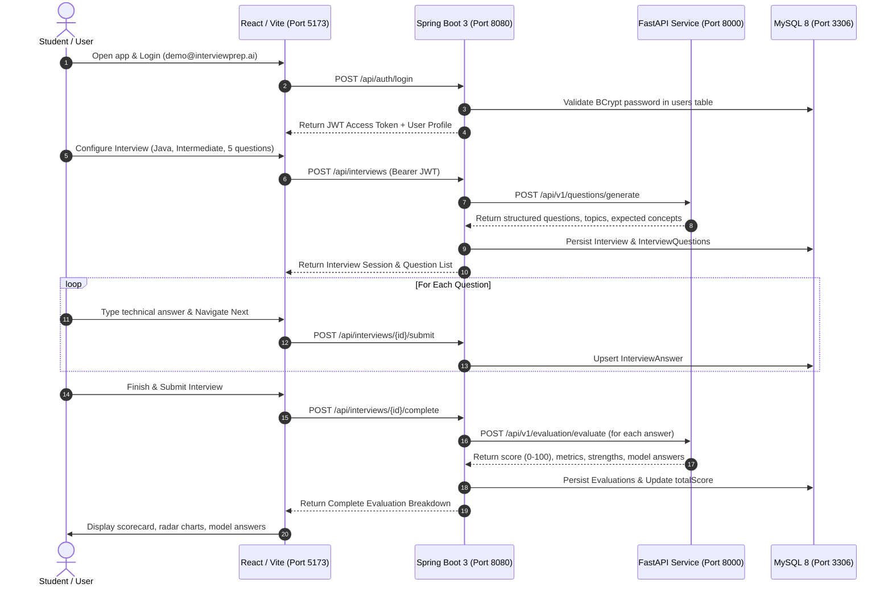

# InterviewPrep AI – AI-Powered Interview Preparation Platform


**InterviewPrep AI** is an enterprise-grade full-stack technical interview preparation platform designed to help software engineering students and developers master technical and behavioral interviews through AI-generated questions, deterministic evaluation engines, and live LLM integration.

---

## 1. System Architecture

The application is structured into four decoupled, production-grade micro-tiers:

```
InterviewPrep-AI/
│
├── frontend/               # React 18 + Vite + Tailwind CSS + Lucide + Recharts
│   ├── src/
│   │   ├── components/     # TopNavbar, Sidebar, AIModelModal, ProtectedRoute
│   │   ├── context/        # AuthContext, InterviewContext
│   │   ├── data/           # Real-world technical question banks
│   │   ├── pages/          # Dashboard, StartInterview, InterviewSession, Evaluation, History, Performance, Profile
│   │   ├── services/       # api.js, authService.js, interviewService.js, evaluationService.js, historyService.js
│   │   └── utils/          # Rule-based deterministic evaluator engine
│   └── package.json
│
├── backend/                # Java 21 + Spring Boot 3.3.5 + Spring Security + JWT + JPA
│   ├── src/main/java/com/interviewprep/
│   │   ├── config/         # SecurityConfig, WebClientConfig
│   │   ├── controller/     # AuthController, InterviewController, EvaluationController, PerformanceController, HealthController
│   │   ├── dto/            # Request/Response data transfer objects
│   │   ├── entity/         # User, Interview, InterviewQuestion, InterviewAnswer, Evaluation
│   │   ├── exception/      # GlobalExceptionHandler & custom exceptions
│   │   ├── repository/     # Spring Data JPA repositories
│   │   ├── security/       # JwtTokenProvider, JwtAuthenticationFilter, UserPrincipal, CustomUserDetailsService
│   │   ├── service/        # AuthService, InterviewService, EvaluationService, PerformanceService, AiServiceClient
│   │   └── InterviewPrepApplication.java
│   ├── src/main/resources/
│   │   ├── application.properties        # MySQL configuration
│   │   ├── application-dev.properties    # In-memory H2 standalone dev profile
│   │   └── db/migration/V1__initial_schema.sql # Flyway migration
│   └── pom.xml             # Maven configuration with wrapper
│
├── ai-service/             # Python 3.11+ FastAPI Microservice
│   ├── app/
│   │   ├── config/         # Pydantic Settings & environment variables
│   │   ├── models/         # Pydantic schemas for questions & evaluations
│   │   ├── routes/         # /health, /api/v1/questions/generate, /api/v1/evaluation/evaluate
│   │   ├── services/       # BaseAIProvider, MockAIProvider, GeminiAIProvider
│   │   └── main.py         # FastAPI application entrypoint
│   ├── tests/              # Pytest test suite (6 passing test cases)
│   ├── requirements.txt
│   └── .env.example
│
├── database/               # MySQL 8+ Database Schema & Migration Guides
│   ├── schema.sql          # Full DDL with indexes and demo user seed
│   └── README.md           # Database setup guide
│
├── .gitignore
└── README.md
```

---

## 2. End-to-End Workflow



---

## 3. Technology Stack

| Layer | Technology | Version | Purpose |
| :--- | :--- | :--- | :--- |
| **Frontend** | React + Vite | 18.3 / 6.4 | SPA UI with hot module reloading |
| **Styling** | Tailwind CSS | 3.4.17 | SaaS-grade responsive dark navy theme |
| **Icons & Charts**| Lucide React & Recharts | Latest | Dashboard metrics & trend visualizations |
| **HTTP Client** | Axios | 1.7.9 | Request interceptors with JWT authentication |
| **Backend** | Java OpenJDK | 21 | Modern high-performance Java runtime |
| **Framework** | Spring Boot | 3.3.5 | Production REST API & dependency injection |
| **Security** | Spring Security + JJWT | 6.3 / 0.12.6 | Stateless JWT authorization & BCrypt hashing |
| **Database ORM**| Spring Data JPA / Hibernate | 6.5 | Object-relational mapping |
| **Database** | MySQL Server | 8.0+ | Persistent relational storage |
| **Migrations** | Flyway | 10.x | Automated versioned schema migrations |
| **AI Microservice**| Python FastAPI | 0.115+ | High-throughput asynchronous AI microservice |
| **Validation** | Pydantic v2 | 2.10+ | Schema validation and serialization |
| **AI Engine** | Provider Abstraction | Mock / Gemini | Transparent deterministic engine or live LLM |

---

## 4. Quick Start Guide

### Step 1: Clone and Enter Project
```bash
cd "c:\Users\ayush\OneDrive\Desktop\ai--power-platefrom - Copy"
```

### Step 2: Set Up Database (MySQL)
Make sure MySQL is running on `localhost:3306`:
```bash
mysql -u root -p < database/schema.sql
```
*Note: If you don't have MySQL installed, you can skip this step! The backend includes a standalone dev profile (`--spring.profiles.active=dev`) that uses an in-memory H2 database automatically.*

---

### Step 3: Run the AI Microservice (Port 8000)
Open a new terminal window:
```powershell
cd ai-service

# Activate virtual environment
.\venv\Scripts\activate

# (Optional) Verify test suite
pytest tests

# Start FastAPI server
uvicorn app.main:app --host 127.0.0.1 --port 8000 --reload
```
API docs will be available at: `http://localhost:8000/docs`

---

### Step 4: Run the Spring Boot Backend (Port 8080)
Open a new terminal window:
```powershell
cd backend

# Option A: Run with MySQL (Default)
.\mvnw.cmd spring-boot:run

# Option B: Run in standalone offline mode (uses in-memory H2, no MySQL required)
.\mvnw.cmd spring-boot:run "-Dspring-boot.run.profiles=dev"
```
The backend will start on: `http://localhost:8080`  
Health check: `http://localhost:8080/api/health`

---

### Step 5: Run the Frontend (Port 5173)
Open a new terminal window:
```powershell
cd frontend

# Start the Vite development server
npm run dev
```
Open your browser and navigate to: **`http://localhost:5173`**

---

## 5. Demo Credentials

The database and local store come pre-seeded with a demo user:

- **Email**: `demo@interviewprep.ai`
- **Username**: `demouser`
- **Password**: `DemoPass123!` *(or `password123`)*
- **Target Role**: Full Stack Developer / Software Engineer

You can also click the **"Quick Demo Access"** button on the Login page to instantly authenticate.

---

## 6. API Reference

### A. Python AI Microservice (`http://localhost:8000`)
- `GET /health` – Microservice operational status, active provider, and uptime.
- `POST /api/v1/questions/generate` – Generates structured technical questions based on technology and difficulty.
- `POST /api/v1/evaluation/evaluate` – Scores student answers (0-100) on correctness, relevance, and completeness with strengths and model answers.

### B. Spring Boot Backend (`http://localhost:8080`)
- `POST /api/auth/register` – Register a new user account.
- `POST /api/auth/login` – Authenticate user and receive JWT bearer token.
- `GET /api/auth/me` – Retrieve current authenticated user profile.
- `PUT /api/auth/profile` – Update user profile.
- `POST /api/interviews` – Create an interview session (calls AI microservice).
- `GET /api/interviews` – List all user interviews.
- `GET /api/interviews/{id}` – Get interview details and question list.
- `POST /api/interviews/{id}/submit` – Submit an answer to a question.
- `POST /api/interviews/{id}/complete` – Complete interview and evaluate all answers.
- `GET /api/interviews/{id}/results` – Get full score breakdown and feedback.
- `DELETE /api/interviews/{id}` – Delete an interview session.
- `GET /api/performance/summary` – High-level metrics for dashboard cards.
- `GET /api/performance/analytics` – Timeline trends and topic strengths.

---

## 7. Dual-Mode Resilience Architecture

The frontend is architected with dual-mode resilience:
1. **Full-Stack Live Mode**: When the Spring Boot backend and FastAPI services are running, all requests are persisted to MySQL with JWT token authentication.
2. **Offline / Standalone Mode**: If the backend is temporarily offline, the frontend seamlessly falls back to LocalStorage and the internal deterministic rule-based evaluator, ensuring students can always practice without interruption.
